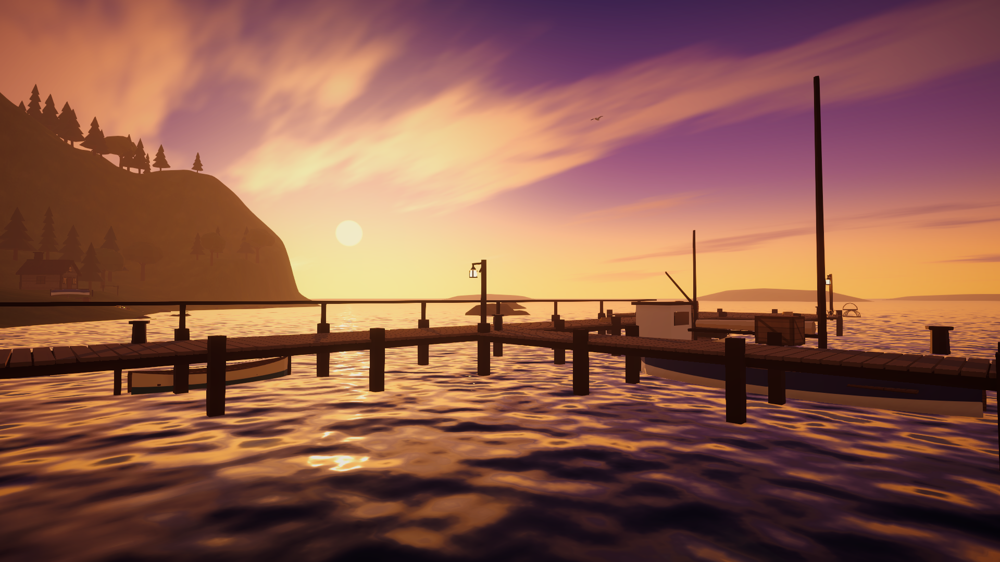

# The Fishing Village at Sunset

A small explorable 3D world built in **Unity 2022.3 (URP)** for *CSE-411 Introduction to Game Development, Mini Project 1: Build a World* (Theme 5).

Fishermen are bringing in the last boats of the day. Wooden houses sit on a slope above a curved harbour, a pier with moored boats runs into the bay, and a red-and-white lighthouse on the eastern cliff is visible from everywhere in the scene. A low golden sun, an orange-pink sky and cool purple water give the place a calm, nostalgic mood.

## Controls

| Key | Action |
| --- | --- |
| W / A / S / D | Move (frame-rate independent) |
| Q / E | Down / up |
| Left Shift | Move faster |
| Arrow keys (or hold right mouse) | Look around |
| 1 / 2 / 3 | Viewpoints: Hillside Arrival, Pier End, Lighthouse Headland |

## Opening the project

1. Clone the repo and open the folder in **Unity 2022.3.62f3** (or another 2022.3 LTS release).
2. Open `Assets/Scenes/FishingVillage_Sunset.unity` and press **Play**. Click in the Game view so it receives the keys.

## What's in the world

- **Terrain:** a sculpted coastline with a bay, cliff headlands, a hillside village and mountains closing off the south. It has 5 blended texture layers, terrain trees (3 types) and dune grass.
- **Landmark:** the lighthouse, with a rotating beam and spotlight.
- **Points of interest:** the village square (well, fish stall, cart), the harbour (pier, 5 boats, nets, stockfish racks, lobster pots) and the cove (campfire, a rowboat under repair).
- **Lighting:** a low WNW sun with long soft shadows, a hand-written sunset skybox shader, peach exponential fog that hides the world's edges, 11 point and spot lights, emissive windows and lanterns, bloom and ACES tonemapping.
- **Ambient motion:** bobbing boats and buoys, the rotating lighthouse beam, swinging and flickering lanterns, circling gulls, scrolling sea ripples and chimney smoke.

## Scripts

Runtime scripts are in `Assets/Scripts`. All tunable values are `[SerializeField] private` fields, and there are no `GameObject.Find` calls.

- `ExplorerCamera` handles the WASD/QE explorer, viewpoint keys 1–3 and world bounds.
- `BoatBob`, `Rotator`, `SwayMotion`, `LightFlicker`, `GullCircle` and `WaterScroll` drive the ambient motion.

Editor tools are in `Assets/Editor`, under the **Tools > Fishing Village** menu:

- `VillageBuilder` rebuilds the whole scene: terrain, meshes, materials, lighting and viewpoints.
- `SceneCapture` exports the deliverable screenshots.
- `WalkthroughRecording` renders the walkthrough video.

## Deliverables

All deliverables are in [`Deliverables/`](Deliverables):

- `Walkthrough_FishingVillage.mp4`, a 72-second walkthrough
- four screenshots: the three viewpoints and the best shot
- `Design_Note_MP1.pdf`
- `Layout_Plan.png`
- `Demo_CheatSheet_MP1.pdf`

## Credits

No external asset packs were used. Every model, texture, material and the skybox was created for this project. See [`Assets/CREDITS.txt`](Assets/CREDITS.txt).
